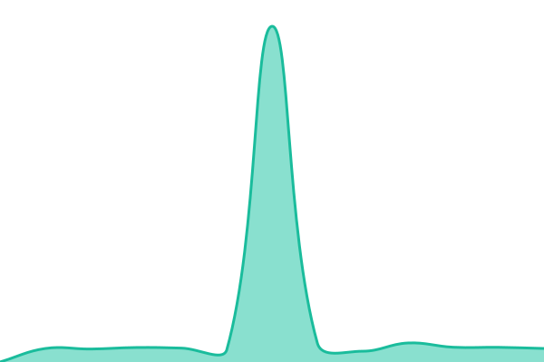

# [📈 Live Status](https://beotam.github.io/upptime): <!--live status--> **🟧 Partial outage**

This repository contains the open-source uptime monitor and status page for [beotam](https://beotam.github.io/upptime), powered by [Upptime](https://github.com/upptime/upptime).

With [Upptime](https://upptime.js.org), you can get your own unlimited and free uptime monitor and status page, powered entirely by a GitHub repository. We use [Issues](https://github.com/beotam/upptime/issues) as incident reports, [Actions](https://github.com/beotam/upptime/actions) as uptime monitors, and [Pages](https://beotam.github.io/upptime) for the status page.

<!--start: status pages-->
<!-- This summary is generated by Upptime (https://github.com/upptime/upptime) -->
<!-- Do not edit this manually, your changes will be overwritten -->
<!-- prettier-ignore -->
| URL | Status | History | Response Time | Uptime |
| --- | ------ | ------- | ------------- | ------ |
|  [BeoTam Main](https://beotam.com) | Hoạt động | [beo-tam-main.yml](https://github.com/beotam/upptime/commits/HEAD/history/beo-tam-main.yml) | 

 7462ms
     
 | 

<a href="https://status.beotam.com/history/beo-tam-main">88.64%</a>
    

|  [BeoTam Admin](https://admin.beotam.com) | Hoạt động | [beo-tam-admin.yml](https://github.com/beotam/upptime/commits/HEAD/history/beo-tam-admin.yml) | 

 652ms
     
 | 

<a href="https://status.beotam.com/history/beo-tam-admin">92.82%</a>
    

|  [BeoTam Media](https://media.beotam.com) | Gián đoạn | [beo-tam-media.yml](https://github.com/beotam/upptime/commits/HEAD/history/beo-tam-media.yml) | 

 328ms
     
 | 

<a href="https://status.beotam.com/history/beo-tam-media">0.01%</a>
    

|  [BeoTam New](https://new.beotam.com/) | Hoạt động | [beo-tam-new.yml](https://github.com/beotam/upptime/commits/HEAD/history/beo-tam-new.yml) | 

 156ms
     
 | 

<a href="https://status.beotam.com/history/beo-tam-new">100.00%</a>
    

<!--end: status pages-->

[**Visit our status website →**](https://beotam.github.io/upptime)

## 📄 License

- Powered by: [Upptime](https://github.com/upptime/upptime)
- Code: [MIT](./LICENSE) © [Anand Chowdhary](https://anandchowdhary.com)
- Data in the `./history` directory: [Open Database License](https://opendatacommons.org/licenses/odbl/1-0/)
